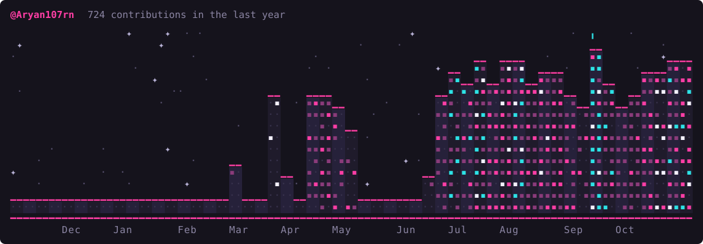

# Hi, I'm Aryan Nakade 👋

### Backend & Full-Stack Developer

I build practical web applications and backend services, with a focus on **Node.js, TypeScript, APIs, and databases**.

---

## About me

- I enjoy turning ideas into useful, well-structured software.
- I work across frontend and backend, from React interfaces to REST APIs.
- I’m currently developing my skills in **cloud engineering, system design, and distributed systems**.

## Featured projects

### [Web Inspectra](https://github.com/Aryan107rn/Web_Inspectra)
An AI-powered website diagnostics platform covering performance, accessibility, security, DOM structure, network activity, and technology detection.

**React · TypeScript · Node.js · Express · Gemini AI · Cheerio** · [Live demo](https://web-inspectra-frontend-main.vercel.app)

### [VerityBench](https://github.com/Aryan107rn/VerityBench)
An evidence-first platform for testing AI agents, simulating failures, and independently checking whether their actions are reliable.

**Python · FastAPI · React · TypeScript · Docker**

### [CPU Scheduling Visualizer](https://github.com/Aryan107rn/CPU_Scheduling_Visualizer)
An interactive visualizer for exploring CPU scheduling algorithms, comparing execution timelines, and understanding performance metrics.

**React · TypeScript · Vite** · [Live demo](https://cpu-scheduling-visualizer-flame.vercel.app/)

### [BranchMind](https://github.com/Aryan107rn/Branch_Mind)
A collaborative AI workspace for organizing ideas and building connected knowledge structures.

**React · JavaScript · Node.js · Express · Cognee**

## Technologies

**Languages:** C++ · JavaScript · TypeScript · Python  
**Frontend:** React · Tailwind CSS · Vite  
**Backend:** Node.js · Express · REST APIs  
**Databases:** PostgreSQL · MongoDB  
**Tools:** Git · GitHub · Linux · Docker

## GitHub

## Get in touch

Feel free to explore my repositories or connect with me on [GitHub](https://github.com/Aryan107rn).

---
## My GitHub Skyline 🌆

> Build thoughtfully. Keep learning. Ship useful things.
